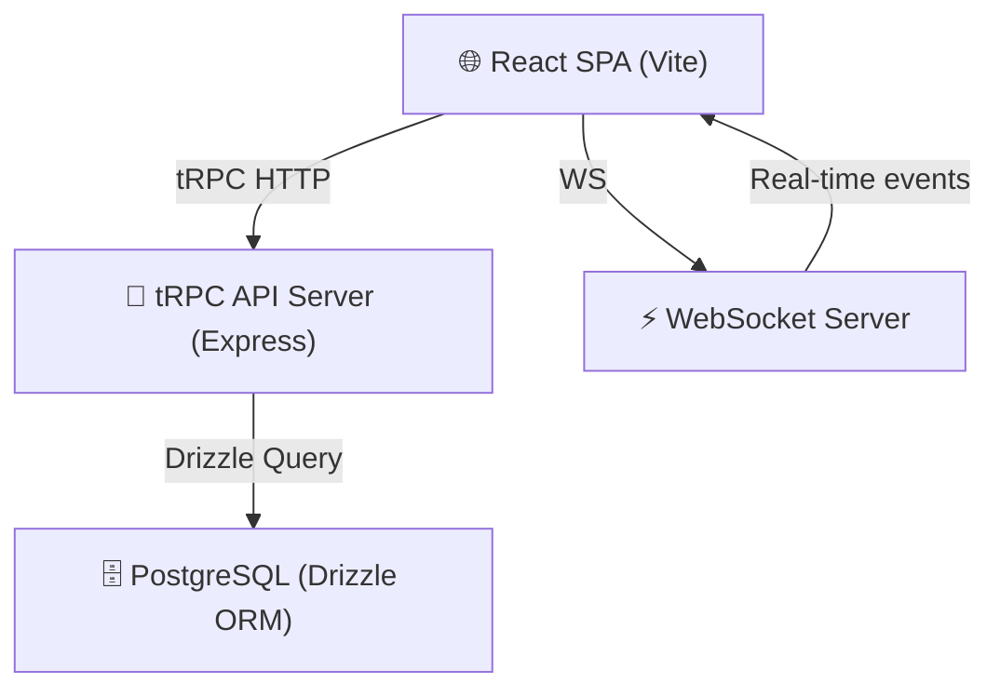

# 🗺️ Zühre Planet — Proje Harita & Dokümantasyon

> **Sürüm:** V4.0 Shadow Diamond Edition  
> **Oluşturma:** Nisan 2026  
> **Mimari:** React + Vite + tRPC + Drizzle ORM + PostgreSQL

---

## 📑 İçindekiler

1. [Mimari Genel Bakış](#mimari-genel-bakış)
2. [Klasör Yapısı](#klasör-yapısı)
   - [src/pages](#srcpages)
   - [src/components](#srccomponents)
   - [src/contexts](#srccontexts)
   - [src/hooks](#srchooks)
   - [src/services](#srcservices)
   - [src/lib](#srclib)
   - [src/types](#srctypes)
   - [src/data](#srcdata)
   - [src/constants](#srcconstants)
   - [src/locales](#srclocales)
   - [server/](#server)
3. [Route Haritası](#route-haritası)
4. [Provider Zinciri](#provider-zinciri)
5. [Durum Etiketleri](#durum-etiketleri)

---

## Mimari Genel Bakış



---

## Klasör Yapısı

### `src/pages`
Uygulama sayfaları — her biri `App.tsx`'e lazy loaded route olarak bağlanır.

```
pages/
├── App.tsx               ── Root router, tüm provider'lar ve route'lar
├── Home.tsx              ── Ana sayfa (Hero, öne çıkan escortlar)
├── Catalog.tsx           ── Escort kataloğu + AdvancedFilterPanel
├── EscortList.tsx        ── Liste görünümü + ProfileQuickViewOverlay
├── EscortProfile.tsx     ── Tek escort profil sayfası
├── NotFound.tsx          ── 404 sayfası
├── AdminDashboard.tsx    ── Admin ana paneli (lazy)
├── ClientRegister.tsx    ── Müşteri kayıt formu
├── EscortRegister.tsx    ── Escort kayıt formu
├── BrandIdentityGallery.tsx  ── Marka kimliği showcase
├── SEO.tsx               ── SEO meta tag yöneticisi (Helmet wrapper)
│
├── auth/                 ── Kimlik doğrulama sayfaları
│   ├── AdminLogin.tsx    ── Admin girişi (rose glow + DevCredentialsPanel)
│   ├── CustomerLogin.tsx ── Müşteri girişi (primary glow + DevCredentialsPanel)
│   └── EscortLogin.tsx   ── Escort girişi (purple glow + DevCredentialsPanel)
│
├── customer/             ── Müşteri dashboard alt sayfaları
│   ├── CustomerDashboard.tsx   ── Genel bakış (stats, randevular, mesajlar)
│   ├── CustomerFavorites.tsx   ── Favori escortlar
│   ├── CustomerAppointments.tsx── Randevu yönetimi
│   ├── CustomerReviews.tsx     ── Yazılan değerlendirmeler
│   ├── CustomerMessages.tsx    ── Mesaj geçmişi
│   ├── CustomerProfile.tsx     ── Profil görüntüleme
│   ├── CustomerSettings.tsx    ── Hesap ayarları
│   ├── CustomerAnalytics.tsx   ── Aktivite analitiği
│   ├── CustomerComplaints.tsx  ── Şikayet merkezi
│   ├── LoyaltyDashboard.tsx    ── Sadakat puanları & ödüller
│   ├── Wallet.tsx              ── NP (Nebula Points) cüzdan
│   ├── History.tsx             ── İşlem geçmişi
│   ├── Notifications.tsx       ── Bildirimler
│   ├── AdvancedMediaSearch.tsx ── Medya arama
│   └── DetailedListingPage.tsx ── İlan detay sayfası
│
├── dashboard/            ── Escort dashboard alt sayfaları
│   ├── EscortDashboard.tsx     ── Escort ana paneli
│   ├── ProfileEditor.tsx       ── Profil düzenleme
│   ├── ImageEditor.tsx         ── Fotoğraf yönetimi
│   ├── ScheduleManager.tsx     ── Takvim & müsaitlik
│   ├── InteractionsCenter.tsx  ── Etkileşimler merkezi
│   ├── EscortLoyalty.tsx       ── Escort sadakat sistemi
│   ├── CustomerIntel.tsx       ── Müşteri bilgi paneli
│   └── index.ts                ── Alt sayfa export'ları
│
├── escort/               ── Escort-owned sayfalar (kendi profili)
│   ├── CalendarManager.tsx     ── Takvim yönetimi
│   ├── EarningsReport.tsx      ── Kazanç raporu
│   ├── PhotoManager.tsx        ── Fotoğraf galerisi
│   ├── ProfileEdit.tsx         ── Profil düzenleme (escort görünümü)
│   └── index.ts
│
├── admin/                ── Admin alt sayfaları
│   └── AdminMediaApprovals.tsx ── Medya onay paneli
│
├── general/              ── Genel/public sayfalar
│   ├── About.tsx         ── Hakkımızda
│   ├── Agencies.tsx      ── ✨ Onaylı lüks ajanslar (YENİ V4)
│   ├── Blog.tsx          ── Blog makaleleri
│   ├── Contact.tsx       ── İletişim formu
│   ├── CookiePolicy.tsx  ── Çerez politikası
│   ├── FAQ.tsx           ── Sık sorulan sorular
│   ├── HowItWorks.tsx    ── Nasıl çalışır?
│   ├── KVKK.tsx          ── KVKK metni
│   ├── Nightlife.tsx     ── ✨ Lifestyle & gece hayatı rehberi (YENİ V4)
│   ├── Pricing.tsx       ── Fiyatlandırma planları
│   ├── PrivacyPolicy.tsx ── Gizlilik politikası
│   ├── Safety.tsx        ── Güvenlik rehberi
│   ├── Support.tsx       ── Destek merkezi
│   ├── TermsOfService.tsx── Kullanım koşulları
│   └── Tours.tsx         ── ✨ Uluslararası escort turne takvimi (YENİ V4)
│
├── membership/           ── Üyelik & premium sayfalar
│   ├── CustomerMembership.tsx  ── Müşteri üyelik planları
│   ├── EscortStore.tsx         ── Escort premium özellikleri market
│   └── RedRoom.tsx             ── ✨ VIP/Platinum gizli salon (YENİ V4)
│
└── forum/                ── Forum sistemi
    ├── ForumHome.tsx      ── Forum ana sayfası
    ├── ForumNewTopic.tsx  ── Yeni konu oluştur
    ├── ForumCategory.tsx  ── Kategori sayfası
    └── ForumTopic.tsx     ── Konu detay sayfası
```

---

### `src/components`
Yeniden kullanılabilir React bileşenleri.

#### Root Bileşenler (Doğrudan kullanılan)

| Bileşen | Açıklama | Durum |
|---|---|---|
| `Header.tsx` | Ana navigasyon, logo, auth butonları | ✅ Aktif |
| `Footer.tsx` | Site footer, linkler, telif bilgisi | ✅ Aktif |
| `ProtectedRoute.tsx` | Rol tabanlı erişim denetimi HOC | ✅ Aktif |
| `ErrorBoundary.tsx` | React error boundary | ✅ Aktif |
| `AgeGateOverlay.tsx` | 18+ yaş doğrulama overlay | ✅ Aktif |
| `AgeVerification.tsx` | Yaş doğrulama bileşeni | ✅ Aktif |
| `AdvancedFilterPanel.tsx` | Catalog filtre paneli (VIP filtreler dahil) | ✅ Aktif |
| `BookingForm.tsx` | Randevu/rezervasyon formu | ✅ Aktif |
| `ChatInterface.tsx` | Anlık mesajlaşma arayüzü | ✅ Aktif |
| `ContactLock.tsx` | İletişim bilgisi gizleme/açma | ✅ Aktif |
| `CookieConsent.tsx` | GDPR çerez onay banner | ✅ Aktif |
| `BottomNav.tsx` | Mobil alt navigasyon | ✅ Aktif |
| `ThemeToggle.tsx` | Koyu/açık tema geçişi | ✅ Aktif |

#### Grafik & Analitik

| Bileşen | Açıklama | Durum |
|---|---|---|
| `AnalyticsDashboard.tsx` | Admin analitik dashboard | ✅ Aktif |
| `BarChart.tsx` | Bar grafik bileşeni | ✅ Aktif |
| `DoughnutChart.tsx` | Halka grafik bileşeni | ✅ Aktif |
| `LineChart.tsx` | Çizgi grafik bileşeni | ✅ Aktif |
| `KPICard.tsx` | KPI metrik kartı | ✅ Aktif |

#### Medya & Upload

| Bileşen | Açıklama | Durum |
|---|---|---|
| `EscortMediaUploader.tsx` | Escort medya yükleme (tam özellikli) | ✅ Aktif |
| `IntegratedMediaUploader.tsx` | Entegre medya yükleyici | ✅ Aktif |
| `PhotoGalleryEnhanced.tsx` | Gelişmiş fotoğraf galerisi | ✅ Aktif |
| `CustomVideoPlayer.tsx` | Özel video oynatıcı | ✅ Aktif |
| `VideoCall.tsx` | Video arama bileşeni | ✅ Aktif |
| `AdvancedPhotoEditor.tsx` | Fotoğraf düzenleme aracı | ✅ Aktif |
| `AdvancedVideoEditor.tsx` | Video düzenleme aracı | ✅ Aktif |
| `GalleryInteraction.tsx` | Galeri etkileşim bileşeni | ✅ Aktif |

#### Ödeme & Üyelik

| Bileşen | Açıklama | Durum |
|---|---|---|
| `PaymentCheckout.tsx` | Ödeme akışı | ✅ Aktif |
| `PaymentMethodForm.tsx` | Ödeme yöntemi formu | ✅ Aktif |
| `PaymentSecurity.tsx` | Güvenli ödeme katmanı | ✅ Aktif |
| `CreditPurchasePanel.tsx` | Kredi satın alma paneli | ✅ Aktif |
| `CreditBasedChat.tsx` | Kredi tabanlı sohbet sistemi | ✅ Aktif |
| `SubscriptionPlanSelector.tsx` | Abonelik planı seçici | ✅ Aktif |
| `LoyaltyDashboard.tsx` | Sadakat programı dashboard | ✅ Aktif |
| `TierGate.tsx` | Üyelik tier erişim kapısı | ✅ Aktif |

#### ⚠️ Dead/Unused Bileşenler (Temizlenecek)

| Bileşen | Neden Kullanılmıyor | Önerilen Aksiyon |
|---|---|---|
| `CosmicNav.tsx` | `Header.tsx` ile replaced | 🗑️ Sil |
| `ModernNavBar.tsx` | `Header.tsx` ile replaced | 🗑️ Sil |
| `FloatingNavigation.tsx` | `BottomNav.tsx` ile replaced | 🗑️ Sil |
| `CustomIcon.tsx` | `ThemeIcon.tsx` ile replaced | 🗑️ Sil |
| `AdvancedFilter.tsx` | `AdvancedFilterPanel.tsx` kullanılıyor | 🗑️ Sil |
| `SpaceBackground.tsx` | `UniverseScene` ile replaced | 🗑️ Sil |
| `SpaceTheme.tsx` | Kullanılmıyor | 🗑️ Sil |
| `StarryBackground.tsx` | Kullanılmıyor | 🗑️ Sil |
| `DiscoveryFeed.tsx` | Hiçbir sayfada import yok | 🔍 Kontrol Et |
| `AdminLoginPage.tsx` (root) | `auth/AdminLoginPage.tsx` duplikasyonu | 🗑️ Sil |
| `ProfileEditor.tsx` (root) | `dashboard/ProfileEditor.tsx` duplikasyonu | 🔍 Kontrol Et |
| `ImageEditor.tsx` (root) | `dashboard/ImageEditor.tsx` duplikasyonu | 🔍 Kontrol Et |

#### `/auth` Alt Klasörü

| Bileşen | Açıklama |
|---|---|
| `AdminLoginPage.tsx` | Admin giriş formu bileşeni |
| `CustomerLoginPage.tsx` | Müşteri giriş formu bileşeni |
| `EscortLoginPage.tsx` | Escort giriş formu bileşeni |
| `DevCredentialsPanel.tsx` | ✨ Hızlı geliştirici giriş paneli (V4 YENİ) |
| `ProfileCompleteModal.tsx` | Profil tamamlama modal |
| `RegisterModal.tsx` | Kayıt modal |

---

### `src/contexts`
React Context Provider'ları — global durum yönetimi.

| Context | Açıklama | Provider Katmanı |
|---|---|---|
| `AuthContext.tsx` | Kullanıcı kimlik doğrulama, rol, oturum | 5. Katman |
| `ThemeContext.tsx` | Koyu/açık tema durumu | 2. Katman |
| `LuxuryThemeContext.tsx` | Cinematic efekt tema durumu | 4. Katman |
| `LanguageContext.tsx` | TR/EN çoklu dil desteği | 3. Katman |
| `NotificationContext.tsx` | Bildirim kuyruğu ve gösterimi | 5. Katman |
| `WebSocketContext.tsx` | Gerçek zamanlı bağlantı ve mesajlaşma | 6. Katman (En dış) |
| `AdminSettingsContext.tsx` | Admin konfigürasyon ayarları | 4. Katman |
| `AnalyticsContext.tsx` | Analytics event sistemi | ✅ Mevcut |

---

### `src/hooks`
Özel React hook'ları.

| Hook | Açıklama |
|---|---|
| `useAdminData.ts` | Admin paneli için veri hook'ları |
| `useAnalytics.ts` | Analitik event izleme |
| `useChat.ts` | Mesajlaşma sistemi hook'u |
| `useClientRegisterForm.ts` | Müşteri kayıt formu validation |
| `useEscortRegisterForm.ts` | Escort kayıt formu validation |
| `useLoyalty.ts` | Sadakat puanı işlemleri |
| `useMediaQuery.ts` | Responsive breakpoint hook |
| `useTheme.ts` | Tema değiştirme hook'u |
| `admin/` | Admin'e özel sub-hook'lar |
| `api/` | API çağrı hook'ları |

---

### `src/services`
İş mantığı ve API servisleri.

| Servis | Açıklama |
|---|---|
| `adminApi.ts` | Admin API çağrıları (tüm CRUD) |
| `listingService.ts` | İlan listeleme ve filtreleme servisi |
| `mockWebSocket.ts` | Geliştirme mock WebSocket |
| `scoutService.ts` | Scout/keşif servis katmanı |
| `videoProcessingService.ts` | Video işleme ve optimizasyon |
| `api/` | tRPC router endpoint tanımları |

---

### `src/lib`
Yardımcı kütüphaneler ve konfigürasyonlar.

| Dosya | Açıklama |
|---|---|
| `trpc.tsx` | tRPC client başlatma ve TRPCProvider |
| `db.ts` | Drizzle ORM veritabanı bağlantısı |
| `utils.ts` | Genel yardımcı fonksiyonlar (cn(), vb.) |
| `animations.ts` | Framer Motion animasyon preset'leri |
| `chatFilter.ts` | Sohbet içerik filtreleme |
| `loyaltySystem.ts` | Sadakat puanı hesaplama mantığı |
| `logger.ts` | Server-side loglama |
| `browserLogger.ts` | Client-side loglama |
| `iyzico.ts` | Iyzico ödeme entegrasyonu |
| `storage.ts` | Local storage yardımcıları |
| `_core/` | Çekirdek utility modülleri |
| `analytics/` | Analytics sistem modülleri |
| `email/` | E-posta gönderim sistemi |
| `monitoring/` | Performans ve hata izleme |
| `notifications/` | Bildirim sistemi |
| `payment/` | Ödeme sistemi soyutlaması |
| `security/` | Güvenlik utilityleri |

---

### `src/types`
TypeScript tip tanımlamaları.

| Dosya | Açıklama |
|---|---|
| `admin.ts` | Admin tip tanımları (User, Report, vb.) |
| `analytics.ts` | Analitik event tipleri |
| `domain.ts` | Ana domain tipleri (Escort, Listing, vb.) |
| `filter.ts` | Filtre ve arama tipleri |
| `loyalty.ts` | Sadakat sistemi tipleri |
| `message.ts` | Mesajlaşma tipleri |
| `notification.ts` | Bildirim tipleri |
| `notifications.ts` | Bildirim sistemi genişletilmiş tipleri |
| `payment.ts` | Ödeme işlem tipleri |
| `reviews.ts` | Değerlendirme tipleri |
| `reviewsExtended.ts` | Genişletilmiş değerlendirme tipleri |
| `role.ts` | Kullanıcı rolü tip sistemi |
| `websocket.ts` | WebSocket mesaj tipleri |

---

### `src/data`
Mock veri ve statik veri dosyaları.

| Dosya/Klasör | Açıklama |
|---|---|
| `mockData/` | Geliştirme için sahte veri setleri |
| `locations.ts` | Türkiye il/ilçe veri listesi (146KB) |
| `planets.ts` | Planets/constellation mock verisi |

---

### `src/constants`
Sabit ve konfigürasyon değerleri.

| Dosya | Açıklama |
|---|---|
| `routes.ts` | Tüm uygulama route sabitlerinin merkezi kaydı |

---

### `src/locales`
Çoklu dil (i18n) destek dosyaları.

---

### `server/`
Backend — tRPC Express sunucusu.

| Dosya | Açıklama |
|---|---|
| `server.ts` | Express sunucu başlatma, middleware, CORS |
| `router.ts` | Ana tRPC router (tüm sub-router'ları birleştirir) |
| `router.core.ts` | Temel router tanımları ve auth context |
| `context.ts` | tRPC request context oluşturma |
| `index.ts` | Sunucu entry point |
| `monitoring.ts` | Request monitoring ve metrics |
| `routers/` | Alt router modülleri (escort, user, admin, vb.) |

---

## Route Haritası

```
/ ──────────────── Home
/catalog ────────── Escort Kataloğu
/escorts ─────────── Escort Listesi
/profile/:id ──────── Escort Profili
/escort/:id ──────── Escort Profili (alias)

/login ──────────── Müşteri Girişi
/escort/login ───── Escort Girişi
/admin/login ────── Admin Girişi
/register ─────────── Müşteri Kayıt
/register-client ─── Müşteri Kayıt (alias)
/register-escort ─── Escort Kayıt

/dashboard ─────────── Müşteri Dashboard
/customer/dashboard ── Müşteri Dashboard (alias)
/escort/dashboard ──── Escort Dashboard
/admin/dashboard ────── Admin Dashboard

/dashboard/profile ──── Escort: Profil Düzenle
/dashboard/gallery ──── Escort: Fotoğraf Yöneticisi
/dashboard/schedule ─── Escort: Takvim
/dashboard/interactions── Escort: Etkileşimler
/dashboard/loyalty ───── Escort: Sadakat
/dashboard/intel ─────── Müşteri Zekası

/messages ──────── Mesajlar
/favorites ──────── Favoriler
/appointments ───── Randevular
/reviews ─────────── Değerlendirmeler
/customer/loyalty ── Sadakat Paneli
/dashboard/wallet ── Cüzdan
/membership ──────── Üyelik Planları
/dashboard/store ─── Escort Premium Store
/red-room ─────────── 🔴 The Red Room (VIP+)

/tours ──────────── Turneler
/agencies ──────── Ajanslar
/nightlife ─────── Gece Hayatı

/forum ──────────── Forum Ana
/forum/new-topic ── Forum Yeni Konu
/forum/:slug ────── Forum Kategori
/forum/topic/:slug── Forum Konu

/blog ────────────── Blog
/about ───────────── Hakkımızda
/pricing ──────────── Fiyatlandırma
/contact ──────────── İletişim
/terms-of-service ─── Kullanım Koşulları
/privacy-policy ────── Gizlilik
/cookie-policy ─────── Çerez Politikası
/kvkk ─────────────── KVKK
/safety ─────────────── Güvenlik
/brand-identity ────── Marka Galerisi

* ──────────────────── 404 NotFound
```

---

## Provider Zinciri

```
<TRPCProvider>                      ← API istemci bağlantısı
  <ThemeProvider>                   ← dark/light mode
    <LanguageProvider>              ← TR/EN dil
      <AdminSettingsProvider>       ← Admin konfigürasyonu
        <LuxuryThemeProvider>       ← Cinematic efektler
          <NotificationProvider>    ← Bildirim kuyruğu
            <TooltipProvider>       ← UI tooltip'ler
              <AuthProvider>        ← Kullanıcı oturumu & roller
                <WebSocketProvider> ← Gerçek zamanlı bağlantı
                  <App />
```

---

## Durum Etiketleri

| Etiket | Anlam |
|---|---|
| ✅ Aktif | Üretimde kullanılıyor |
| ✨ YENİ V4 | Bu sürümde eklendi |
| 🔍 Kontrol Et | Duplicate şüphesi var |
| 🗑️ Sil | Kullanılmıyor, silinmeli |
| ⚠️ Dikkat | Potansiyel sorun |
| 📋 TODO | Eksik/tamamlanmamış |
